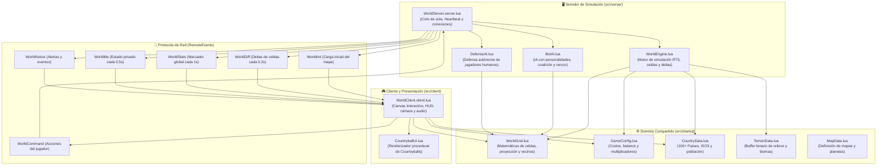
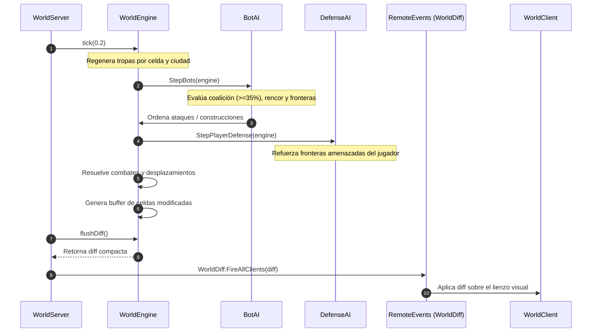

# 🏛️ Arquitectura Modular — Dominación Mundial Total

Documento técnico de diseño, arquitectura y referencia para desarrolladores, colaboradores y mantenimiento a largo plazo de **Dominación Mundial Total**.

---

## 🧭 1. Visión y Principios de Diseño

1. **Autoridad Absoluta del Servidor (*Server-Authoritative*):**
   Toda la simulación (cálculo de tropas, combate, ocupación de celdas, economía, construcciones, misiles e IA) reside exclusivamente en el servidor (`src/server/`). El cliente nunca modifica el estado del juego directamente; únicamente envía intenciones de acción validadas mediante `RemoteEvents`.

2. **Replicación Delta Eficiente (*Delta Compression*):**
   Una cuadrícula global de 960x400 celdas contiene 384,000 puntos de datos. Replicar la cuadrícula completa en cada fotograma saturaría el ancho de banda de red. Por tanto, el motor utiliza un buffer de diferencias (`WorldDiff`): solo se transmiten a los clientes las celdas que sufrieron cambios de dueño o de estado durante el último tick de simulación (200 ms).

3. **Arquitectura Desacoplada y Orientada a Datos (*Data-Driven*):**
   Las reglas de balance, propiedades de edificios, países del mundo, alturas de terreno y personalidades de IA están desacopladas en módulos puros en `src/shared/`. Esto permite modificar costos, velocidades o probabilidades sin tocar el núcleo del motor.

4. **Escalabilidad Algorítmica (Muestreo Adaptativo / *Stride*):**
   Las naciones grandes pueden abarcar decenas de miles de celdas. Para evitar caídas de fotogramas en el servidor (*heartbeat lag*), los módulos de IA aplican muestreo adaptativo por pasos proporcionales al tamaño territorial.

---

## 📐 2. Diagrama General de Arquitectura



---

## 📂 3. Desglose Detallado de Módulos

### 3.1. Capa Compartida (`src/shared/`)

| Archivo | Responsabilidad Principal | Interacción con otros módulos |
| :--- | :--- | :--- |
| `WorldGrid.lua` | Define la geometría de la cuadrícula (960x400 en Tierra), traslación de coordenadas 2D a índice unidimensional `(x + y * W)`, cálculo de distancias esféricas y búsqueda de vecinos adyacentes (N, S, E, O con envoltura toroidal horizontal). | Utilizado por `WorldEngine`, `BotAI`, `DefenseAI` y `WorldClient`. |
| `CountryData.lua` | Contiene el censo de más de 100 naciones reales extraídas de *Natural Earth*, con códigos ISO3, continentes asignados, población histórica y cantidad de celdas asignadas en el mapa. | Proporciona datos de inicio para el modo `COUNTRIES` y nombres de naciones bot. |
| `TerrainData.lua` | Decodifica en memoria un buffer comprimido de 1.15 MB correspondiente al relieve topográfico global precomputado (960x400 RGB). | Modifica costes de movimiento, defensas naturales en montañas y visibilidad de biomas. |
| `GameConfig.lua` | Archivo central de balance: costos de construcción (Ciudad, Puerto, Fuerte, Silo), tasas de regeneración de tropas, daño de misiles nucleares, factores de dificultad y colores de facciones. | Consumido por el cliente para el HUD y por el servidor para validar compras y cálculos. |
| `MapData.lua` | Almacena definiciones de planetas adicionales (Tierra, Marte, Luna) y matrices de juego personalizadas. | Permite instanciar partidas en diferentes escenarios. |

---

### 3.2. Capa Servidor (`src/server/`)

#### A. `WorldServer.server.lua` (Script Principal de Red y Ciclo de Vida)
* **Entrada del Servidor:** Gestiona eventos de jugadores entrantes (`PlayerAdded`) y salientes (`PlayerRemoving`).
* **Canalización de Comandos (`WorldCommand`):** Valida peticiones del cliente con limitación de frecuencia (*rate limiting* a 80 ms por comando) para evitar spam o trampas:
  * `PLAY`: Selección de planeta, dificultad, cantidad de bots y modo de juego (`FREE` o `COUNTRIES`).
  * `SPAWN`: Selección de celda capital inicial (disco de radio 5 con validación `isClear(cell, 8)` sin solapamiento).
  * `ATTACK`: Invasión de celda vecina u operación anfibia con porcentaje de tropas asignado (`20%`, `40%`, `60%`, `80%`, `100%`).
  * `BUILD`: Construcción de edificios (`City` 500, `Port` 400, `Post` 350, `Silo` 1200).
  * `NUKE`: Lanzamiento de ojiva nuclear (`900 Oro`, radio `16`) contra una celda objetivo.
  * `RETREAT`: Repliegue táctico de tropas a territorio seguro.
  * `DEFENSE_AI`: Conmutación de asistencia de defensa automatizada.
* **Bucle Heartbeat:**
  * Acumulador de simulación a `0.2s`: ejecuta `engine:tick(0.2)` y difunde `WorldDiff` a todos los clientes.
  * Cada `0.5s`: actualiza el estado privado de cada jugador vía `WorldMe`.
  * Cada `1.0s`: transmite estadísticas globales de partida vía `WorldStats`.
  * Control de reinicio automático 20 segundos después de declararse una victoria.

#### B. `WorldEngine.lua` (Núcleo de Simulación RTS)
* **Estructuras de Datos:**
  * `cells`: Array lineal de 384,000 elementos que almacena `[ownerId, troops, buildingType, terrainType]`.
  * `nations`: Tabla de naciones activas (humanos y bots) con capital, color representativo, tropas totales, edificios y estadísticas.
* **Mecánica de Combate:**
  * Simulación de combate por diferencial de tropas aplicando bonificaciones por tipo de terreno y edificios defensores (puestos defensivos).
  * Ocupación de celda al vencer la guarnición enemiga y propagación de tropas remanentes.
* **Gestión de Misiles Nucleares:**
  * Validación de alcance de silo, tiempo de recarga y cálculo de área de efecto radial afectando a guarniciones y estructuras enemigas.
* **Búfer de Diferencias (`flushDiff`):**
  * Empaqueta únicamente las celdas mutadas en el último tick para su transmisión compacta.

#### C. `BotAI.lua` (Inteligencia Artificial de Bots)
* **Personalidades Tácticas Únicas:**
  * **Conquistador (`CONQUEROR`):** Alta agresividad (1.4x), busca decapitar naciones atacando directamente hacia su capital (`spearhead = true`).
  * **Mercader (`MERCHANT`):** Prioriza la construcción de Ciudades y Puertos, manteniendo alta reserva defensiva (30%).
  * **Defensor / Tortuga (`TURTLE`):** Construye múltiples puestos defensivos, alta cautela y fuerte factor de rencor.
  * **Oportunista (`OPPORTUNIST`):** Ataca predominantemente a vecinos débiles o desprotegidos.
  * **Navegante (`ADMIRAL`):** Especializado en proyectar fuerza a través de puertos y rutas marítimas.
  * **Nuclear / Caótico:** Construye silos nucleares con rapidez y ataca a los líderes económicos.
* **Mecánicas Tácticas Colectivas:**
  * **Coalición Anti-Hegemónica:** Cuando cualquier nación controla el **35% o más** de la superficie global, todos los bots entran en modo de coalición y redirigen sus ataques exclusivamente contra el líder.
  * **Memoria de Rencor (*Spite Matrix*):** Registra a las naciones agresoras para responder con contraofensivas proporcionadas.

#### D. `DefenseAI.lua` (Asistente de Defensa para Jugadores Humanos)
* Protege las fronteras de los jugadores que activan el modo autónomo.
* **Sin costo de recursos:** Nunca gasta el oro del jugador ni inicia guerras ofensivas por iniciativa propia.
* **Cálculo de Amenaza (*Threat Score*):** Mide la concentración de tropas enemigas en las fronteras y redistribuye guarniciones desde provincias interiores hacia los frentes bajo peligro inminente.

---

### 3.3. Capa Cliente (`src/client/`)

#### A. `WorldClient.client.lua` (Presentación, Lienzo y Control)
* **Lienzo 2D Interactivo:** Dibuja el mapa mundial con renderizado optimizado por celdas, superponiendo el buffer de relieve terrestre y los colores de soberanía nacional.
* **Cámara Estratégica:** Zoom fluido, paneo con arrastre del ratón, soporte para pantallas táctiles y centrado automático en la capital propia.
* **Interfaz de Usuario (HUD):**
  * Selector de ratio de invasión (`25%`, `50%`, `75%`, `100%`).
  * Botones de construcción de estructuras contextuales sobre celdas propias.
  * Control de lanzamiento de misiles nucleares con retícula táctica.
  * Panel de estadísticas en vivo, lista de líderes territoriales y avisos de eventos mundiales.
* **Sincronización:** Recibe `WorldInit` al ingresar y aplica parches continuos mediante `WorldDiff` directamente sobre el lienzo visual sin recargar el mapa.

#### B. `CountryballUI.lua` (Avatares Procedurales)
* Genera dinámicamente gráficos vectoriales de Countryballs según la nación, facción o personaje histórico (Tesla, Newton, Napoleón, etc.).
* Maneja expresiones faciales dinámicas según el estado del combate (neutral, determinado, furioso, derrotado).

---

## 🔄 4. Ciclo de Vida de un Tick de Simulación (200 ms)



---

## 🛠️ 5. Guía de Extensión y Mantenimiento

### 5.1. Cómo añadir un nuevo tipo de Edificio
1. **Definir en `src/shared/GameConfig.lua`:**
   ```lua
   GameConfig.BUILDINGS.AIRPORT = {
       name = "Aeropuerto",
       icon = "✈️",
       cost = 450,
       requiresBorder = false,
       bonusAttack = 0.20,
   }
   ```
2. **Validar y procesar en `src/server/WorldEngine.lua`:**
   En el método `WorldEngine:build(nation, kind, cell)`, añadir las reglas de colocación y efectos del nuevo edificio.
3. **Añadir botón al HUD en `src/client/WorldClient.client.lua`:**
   Registrar la opción de construcción en el panel contextual de celdas.

### 5.2. Cómo añadir una nueva Personalidad de IA
1. **Definir en `src/server/BotAI.lua`:**
   ```lua
   BotAI.PERSONAS.DIPLOMAT = {
       name = "Diplomático",
       icon = "🕊️",
       aggression = 0.2,
       weak = 0.8,
       spite = 0.5,
       cautious = 1.6,
       ratioMul = 0.6,
       reserve = 0.50,
       extraAttacks = 0,
       cityBase = 2,
       cityPer = 300,
       ports = 1,
       posts = 2,
       silo = false,
       nuke = false,
       spearhead = false,
   }
   ```

### 5.3. Cómo añadir un nuevo Planeta o Mapa
1. Generar la máscara binaria en `tools/` usando una imagen equirrectangular o datos geoespaciales.
2. Registrar las dimensiones y metadatos en `src/shared/WorldGrid.lua` bajo la tabla `WorldGrid.PLANETS`.
3. Sincronizar las opciones de menú en `WorldServer.server.lua` (`sanitize`) y en `WorldClient.client.lua`.

---

## 🧪 6. Herramientas de Compilación y Flujo de Trabajo (Rojo)

* **Sincronización en vivo:** Ejecutar `rojo serve` desde la raíz del repositorio y conectar el plugin de Rojo en Roblox Studio.
* **Compilación de Place:** Ejecutar `rojo build default.project.json -o DominacionMundialTotal.rbxl`.
* **Linter de código:** Ejecutar `selene src/`.
* **Formateador:** Ejecutar `stylua src/`.
